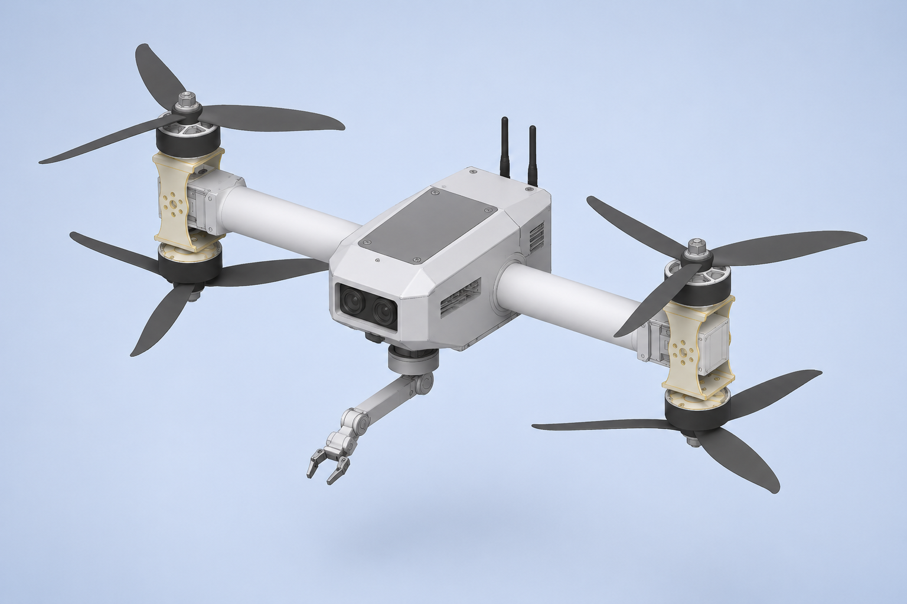
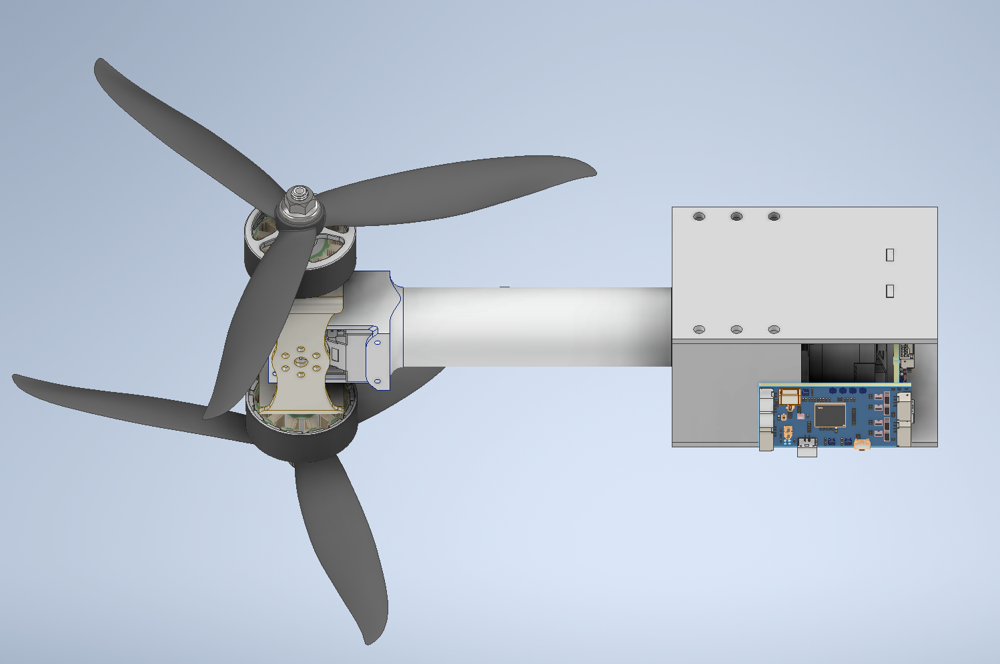
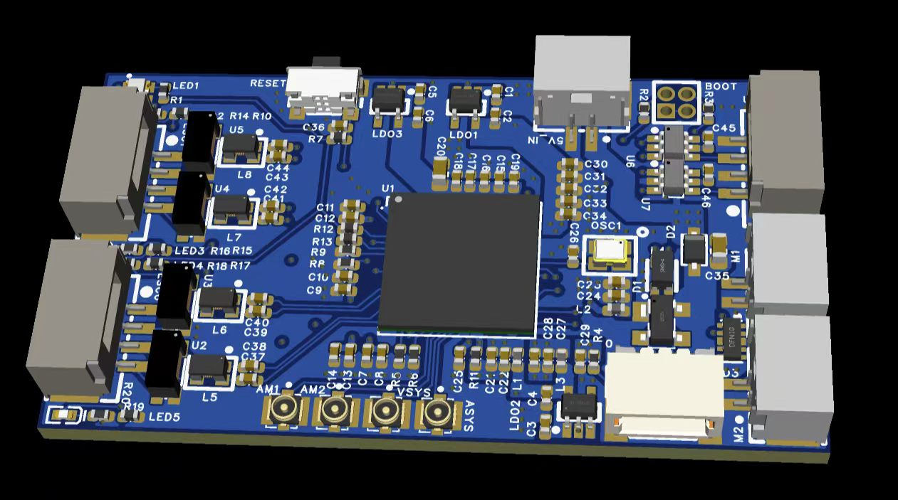
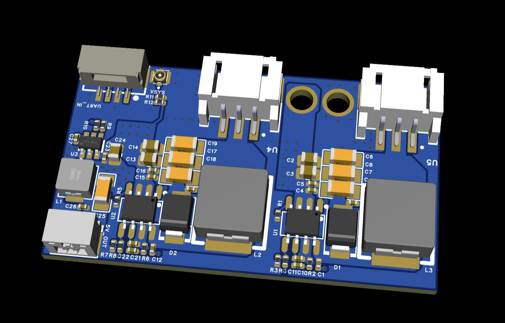
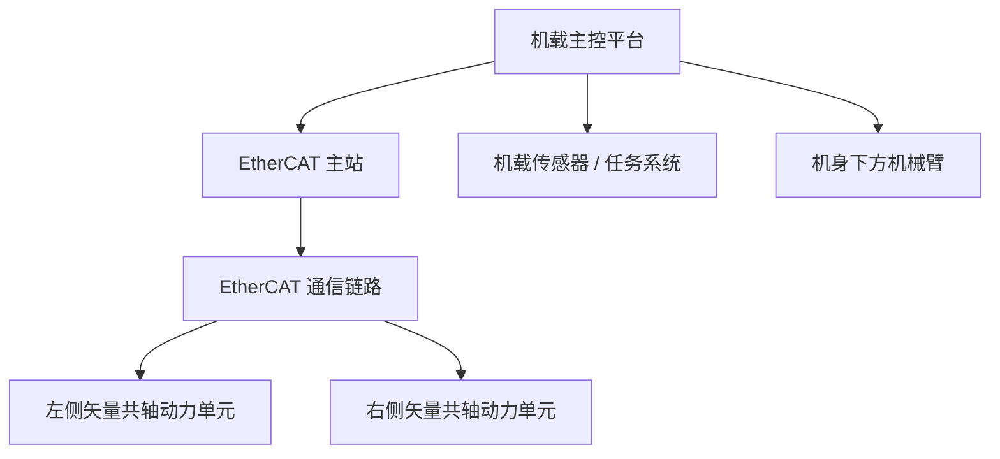

# Ecat Drone Vector Powertrain

  <strong>基于 EtherCAT 的矢量共轴动力单元与空中机器人平台</strong> 
  <em>EtherCAT-based Coaxial Vector Powertrain for Aerial Robotics</em>

  <a href="https://ylh00.github.io/Ecat_Drone_Vector_Powertrain/">
    <strong>🚀 在线项目展示 / Project Website</strong>
  </a>

  
  
  

## 项目简介 | Overview

本项目围绕 EtherCAT 总线下的矢量共轴动力单元开展设计，并以此为基础探索空中机器人的整机硬件架构。项目采用上下双旋翼共轴动力布局，结合矢量调节机构，构建模块化动力执行单元。

**目前已完成的工作：**
- 矢量共轴动力单元结构设计；
- 空中机器人整机机载硬件架构设计；
- 动力单元配套 PCB 硬件设计与开发;
 - LinuxRT 实时运行环境与 EtherCAT 主站部署；
- Simulink 控制模型向 ARM64 Linux 平台生成与部署；

**后续研发方向：**

- 基于地平线 RDK S600 NPU 的动态目标感知与运动预测；
- 机械臂空中击球、精准抓取等交互任务。

## 1. 整机框架 | Overall Framework

  

整机采用左右双侧动力模块对称布局。左右模块通过直线圆柱机臂与中央机身直接连接，机身下方布置一个小型机械臂。中央机身用于承载机载计算、传感器及通信相关硬件。

## 2. 矢量共轴动力单元 | Vector Coaxial Powertrain

  

动力单元采用上下双旋翼共轴布局，集成旋翼、电机、矢量调节机构及配套控制硬件，是整机动力执行系统的核心模块。

设计重点：
- 共轴双旋翼动力布局；
- 矢量调节机构与动力执行结构集成；
- 动力单元模块化设计；
- 面向 EtherCAT 通信与多执行单元协同控制的接口预留。

## 3. PCB 硬件 | PCB Hardware

  
   <em>PCB Board 01</em>

  
   <em>PCB Board 02</em>

围绕动力单元开展配套 PCB 硬件开发，展示板卡器件布局、接口配置及板级集成设计。具体电路功能与接口定义以仓库中的原理图、PCB 工程文件及硬件资料为准。

## 4. 系统架构 | System Architecture

系统规划采用集中计算、分布式执行的架构：机载主控负责整机控制与任务管理，EtherCAT 链路面向动力单元的周期性通信与状态交互。

## 5. 项目进度 | Development Status

### 已完成 | Completed
- [x] 矢量共轴动力单元设计
- [x] 整机机载硬件架构设计
- [x] 动力单元 PCB 硬件开发

### 计划开发 | Planned

- [ ] RDK S600 NPU 端侧 AI 环境搭建
- [ ] 动态目标检测、跟踪与运动预测
- [ ] 机械臂空中击球与精准抓取
- [ ] AI 感知与实时运动控制协同

## Vision

从矢量共轴动力单元出发，逐步构建融合实时控制、端侧 AI 感知与空中交互能力的智能空中机器人平台。

<strong>From Vector Propulsion to Intelligent Aerial Robotics.</strong>

